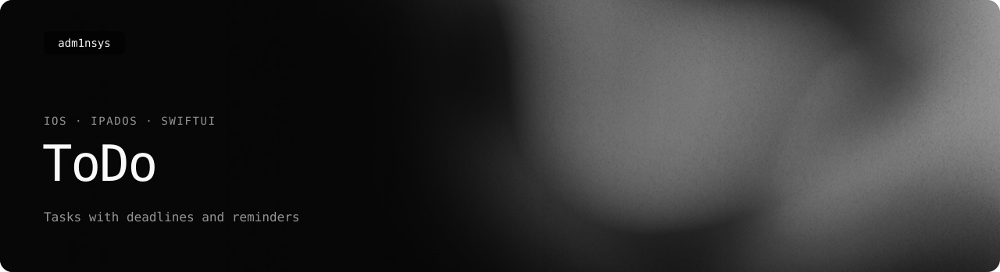
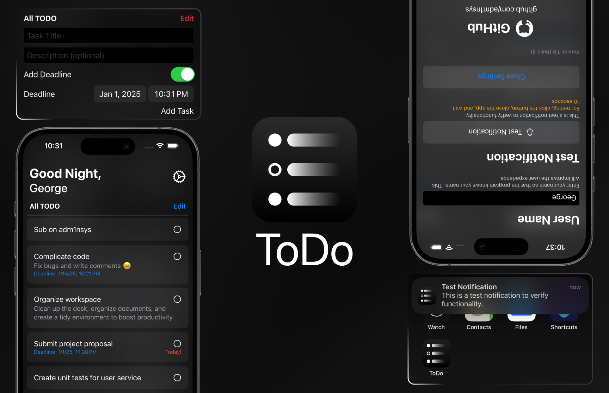

<picture>
  <source media="(prefers-color-scheme: light)" srcset=".github/readme/banner-light.svg">
  
</picture>

  
  
  
  
  

A small to-do app for iPhone and iPad, written in SwiftUI. Tasks get a title, an optional description and an optional deadline; the app reminds you before the deadline and greets you by name depending on the time of day.

## Features

- **Tasks** with a title, an optional description and an optional deadline.
- **Smart order:** open tasks first, overdue ones on top, then by deadline. Each task shows the time left ("2 days", "1h 20m") or how long it is overdue.
- **Notifications** at the deadline, plus optional reminders one day, one hour and one minute before. A test notification in Settings checks that they work.
- **Greeting** by time of day ("Good Morning", "Good Evening", …) with your name, set on first launch.
- **Animated launch screen**, adaptive layout for iPhone and iPad, light and dark mode.
- Tasks and settings are stored on the device (`UserDefaults`); nothing leaves it.

## Requirements

| Platform | Version |
| --- | --- |
| iOS / iPadOS | 15 or later |
| macOS (Designed for iPad) | Apple silicon Mac |
| visionOS (Designed for iPad) | 1 or later |

Built with Xcode 15.2. Tested on a real iPhone SE (1st generation, iOS 15.7.8) and in the iPhone 15 Pro simulator (iOS 17.2).

## Build and run

There is no App Store build. To run it on your own device:

1. Open `ToDo.xcodeproj` in Xcode.
2. Under *Signing & Capabilities* choose your own team (a free Apple ID works).
3. Pick your iPhone or a simulator and press **Run** (⌘R).

## Code

| File | What it does |
| --- | --- |
| `ToDo/ToDoApp.swift`, `ContentView.swift` | App entry, task list state, saving and sorting |
| `ToDo/LoadScreenView.swift` | Animated launch screen |
| `ToDo/Models/TaskListView.swift` | The list, time left until each deadline |
| `ToDo/Models/TaskEditorView.swift` | Adding and editing tasks |
| `ToDo/Models/NotificationService.swift` | Deadline notifications and reminders |
| `ToDo/Models/SettingsView.swift`, `SetUpView.swift` | Settings and the first-launch name prompt |
| `ToDo/Models/Hello.swift` | Greeting by time of day |

## License

[GPL-3.0](LICENSE) © Heorhii Romanenko
